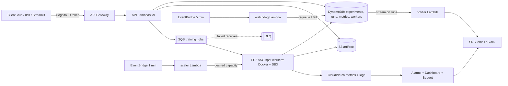

# RL Training and Experimentation Framework on AWS

Submit a reinforcement-learning job through a REST API. The platform queues it, trains it on auto-scaled
EC2 spot workers (Stable Baselines3), tracks every run (config, metrics, checkpoints, models, logs),
monitors health, notifies on completion/failure and controls cost. Everything is deployed with AWS CDK (Python).

## Architecture



Run lifecycle: `SUBMITTED -> QUEUED -> RUNNING -> SUCCEEDED | FAILED | CANCELLED`, plus `REQUEUED`
(spot interruption, retry, stale heartbeat) and `CANCEL_REQUESTED`.

## Quick start

Prerequisites: AWS account + CLI configured, Node 18+, Python 3.11+, Docker.

```bash
pip install -r requirements-dev.txt        # (worker deps need CPU torch: see requirements-dev.txt)
npm install -g aws-cdk
make test                                   # unit tests (moto + CDK assertions)
./scripts/deploy.sh dev you@example.com     # layer, bootstrap, Storage+Messaging, image push, Api+Compute+Monitoring
```

`deploy.sh` prints the API URL, user pool and the commands to create your first user (self sign-up is off).
Confirm the SNS subscription email, then:

```bash
python scripts/smoke_test.py --api <ApiUrl> --client-id <ClientId> --region <region> \
       --username me --password '...' --runs 3
```

Manual steps (same as the script): `cdk deploy StorageStack MessagingStack` -> `make push-image` ->
`cdk deploy ApiStack ComputeStack MonitoringStack`. Teardown: `make destroy` (empties the bucket, `cdk destroy --all`).

### CDK context (cdk.json or `--context k=v`)
`stage` (dev|prod), `owner_email`, `slack_webhook_url`, `max_workers` (5), `max_active_runs_per_user` (5),
`monthly_budget_usd` (50), `instance_type` (c6i.xlarge), `use_spot` (true), `image_tag` (latest).
`prod` retains the bucket/tables/user pool; `dev` destroys them.

## Using it

```bash
python cli/rlctl.py login --api <ApiUrl> --client-id <ClientId> --region <region> --username me
python cli/rlctl.py experiments create "cartpole study"
# edit examples/ppo_cartpole.json -> experiment_id
python cli/rlctl.py submit examples/ppo_cartpole.json --wait
python cli/rlctl.py runs --status RUNNING
python cli/rlctl.py metrics <run_id> --csv
python cli/rlctl.py compare <experiment_id> <run1> <run2> <run3> --threshold 400
python cli/rlctl.py download <run_id> model
streamlit run dashboard/app.py              # experiments, run table, reward overlays, artifact links
```

### REST API (all routes except `/health` need `Authorization: <Cognito ID token>`)
| Method & path | Purpose |
|---|---|
| `POST /experiments`, `GET /experiments` | create / list (cursor pagination) |
| `POST /runs` | submit (body = training config, optional `Idempotency-Key`), returns 202 + `run_id` |
| `GET /runs?experiment_id=&status=&limit=&cursor=` | list runs |
| `GET /runs/{run_id}` | run detail |
| `POST /runs/{run_id}/cancel` | QUEUED -> CANCELLED; RUNNING -> CANCEL_REQUESTED (worker stops gracefully) |
| `GET /runs/{run_id}/metrics?from_step=&to_step=&limit=&cursor=` | metric series |
| `GET /runs/{run_id}/artifacts/{model\|checkpoint\|log\|config}` | 15-minute presigned URL |
| `POST /experiments/{id}/compare` | `{"run_ids":[...], "metric":"ep_rew_mean", "threshold":400}` -> 200-point aligned curves, best/final/AUC/steps-to-threshold, ranking |
| `GET /health` | liveness (mock integration) |

Envelope: `{"data": ..., "error": null}` or `{"data": null, "error": {"code","message"}}`.
Quota: 5 active runs per user (429 `QUOTA_EXCEEDED`), 20 rps / burst 40, 10,000 requests per day.

## Training config
See `examples/ppo_cartpole.json`. Algorithms PPO, A2C, DQN, SAC; envs CartPole-v1, LunarLander-v3, Pendulum-v1,
Acrobot-v1, MountainCar-v0, BipedalWalker-v3. Limits: 5M timesteps, 240 min, hyperparameter keys allowlisted per
algorithm, DQN needs a discrete and SAC a continuous action space. No user code is ever executed.
Each run stores git SHA, library versions, instance type/spot flag and timings for reproducibility
(same config + seed + image tag reproduces results on CPU).

## How failure is handled
| Event | Behaviour |
|---|---|
| Worker crashes / instance killed | SQS message reappears after the visibility timeout (heartbeat keeps extending it while alive); the next worker takes the run over once the heartbeat is stale (>10 min) and resumes from the latest checkpoint. The watchdog also requeues stale runs and fails them with `heartbeat_lost` after 3 attempts. |
| Spot interruption notice | Worker stops, saves + uploads a checkpoint, sets `REQUEUED`, releases the message immediately and exits. An interruption is not counted as a failed attempt. |
| Exception in training | Run set to `REQUEUED`, message retried; on the 3rd attempt the run is `FAILED` and the message goes to the DLQ (alarm fires). Invalid configs fail immediately (no retries). |
| Duplicate SQS delivery | Conditional `QUEUED/REQUEUED -> RUNNING` update; a second worker drops the duplicate. |
| Max runtime | Enforced by the worker (stops gracefully) and by the watchdog (limit + 15 min). |
| Idle workers | After 5 idle minutes a worker removes its scale-in protection and terminates itself (`ShouldDecrementDesiredCapacity`). Idle system = 0 instances. |

## Monitoring and cost
Dashboard `RLPlatform`; alarms (all to SNS): DLQ>0, oldest message >30 min, queued-but-no-workers 10 min,
Lambda errors>3/5min, API 5XX>5/5min, >3 failed runs/hour, worker CPU>95% 30 min; budget alerts at 50/80/100%.
Every resource is tagged `Project=rl-platform`. Worker log group and Lambda log groups keep 30 days;
checkpoints go to IA after 30 days and expire after 90; metrics rows expire after 180 days.
Typical dev month: 5-20 USD (a c6i.xlarge spot hour is roughly 0.05-0.07 USD).

## Tests
`make test` (unit: pydantic rules, every handler with moto, scaler math, watchdog, notifier, worker orchestration incl.
retry/DLQ/cancel/spot/takeover, CDK assertions, CLI). `tests/integration` trains real SB3 jobs against moto
(resume, cancel, spot, metrics) and is skipped when torch is missing. `tests/e2e` (marked `e2e`) injects failures
into a deployed stack; `scripts/load_test.py` checks scale-up and scale-to-zero.

## Local worker mode
`LOCAL_MODE=1` disables IMDS/ASG calls. Point boto3 at LocalStack with `AWS_ENDPOINT_URL=http://localhost:4566` and set
`RUNS_TABLE METRICS_TABLE WORKERS_TABLE BUCKET QUEUE_URL`, then `python worker/main.py`.

## Deliberate deviations from the build spec
1. **Auth**: Cognito user-pool authorizer (your choice) instead of API keys. The owner is the `cognito:username` claim.
   Throttling (20 rps / burst 40) and the 10,000/day quota are applied through the stage and a usage plan, which does not require a key.
2. **ECR repository lives in StorageStack** so the image can be pushed before ComputeStack deploys (matches the deploy order in section 14).
3. **Extra GSI `owner_index` on runs**, needed for `GET /runs` without `experiment_id`.
4. **submit_run writes `QUEUED` before sending the SQS message** (and marks the run `FAILED` if the send fails), so a fast worker can never race the status update.
5. **scaler only scales up**; workers scale themselves down (as in section 8). The ASG does not fall back to on-demand automatically when spot capacity is unavailable (`use_spot=false` switches the pool to on-demand).
6. Worker log group is created in ComputeStack; the "Lambda errors" alarm and dashboard use account-wide Lambda metrics.
7. Budget is account-wide (tag-filtered budgets require activating the `Project` cost-allocation tag first).
8. Eval videos are not recorded (spec: optional). Off-policy algorithms (DQN/SAC) resume from the model checkpoint without the replay buffer.
9. GPU pool and hyperparameter sweeps were not requested and are not included.
